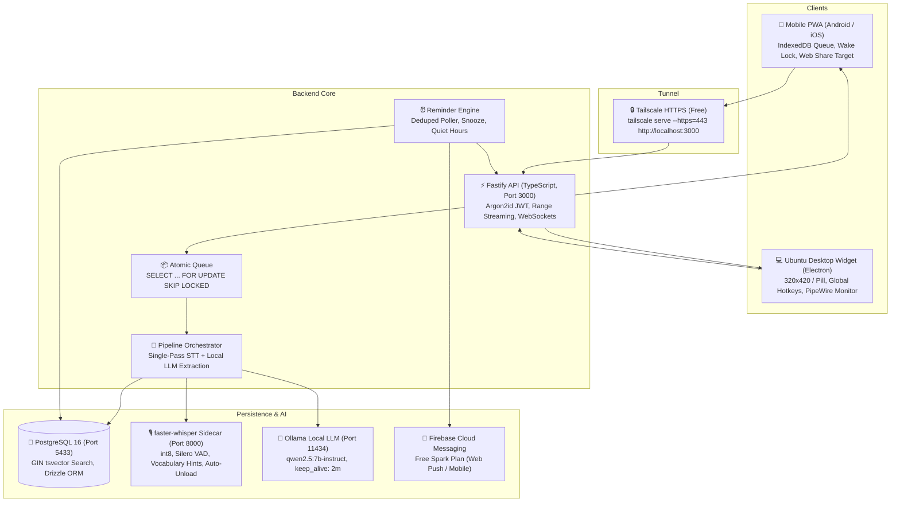

# TaskCatch — Personal AI Voice Task Capture & Reminder System

TaskCatch is a production-grade personal system built for hands-free work instruction capture. When managers or teammates assign work verbally in **Hindi, Gujarati, Hinglish, or English**, TaskCatch lets you **only listen**: it records the conversation on your phone or Ubuntu laptop, auto-transcribes and translates it into English, extracts complete self-contained actionable tasks with resolved deadlines, and keeps you on schedule via Firebase push notifications and an always-on-top Ubuntu desktop widget.

---

## Architecture Overview



---

## Monorepo Workspaces

- `apps/api`: Fastify 4.29 TypeScript REST & WebSocket backend, Drizzle ORM migrations, argon2id single-user JWT auth, atomic PostgreSQL queue, GIN tsvector search.
- `apps/web`: React 18, Vite 5, Tailwind CSS, Lucide icons, installable PWA with Service Worker, Web Share Target, and offline IndexedDB queue.
- `apps/desktop`: Electron frameless always-on-top semi-transparent 320x420 widget, collapse-to-pill mode, global hotkeys (`Ctrl+Alt+R`, `Ctrl+Alt+B`, `Ctrl+Alt+W`), PipeWire/PulseAudio meeting monitor recording, and libnotify native notifications.
- `apps/stt`: FastAPI Python 3.11 sidecar with `faster-whisper` (int8, CPU threads=4, Silero VAD, Indian business vocabulary hints, language remapping, auto-model unload after 300s).
- `packages/shared`: Shared TypeScript types, Zod schemas, and Indian relative-date resolver (`Asia/Calcutta`) supporting Hindi, Gujarati, Hinglish phrases.

---

## 100% Zero-Cost Guarantee

TaskCatch is built strictly on open-source software and permanently free tiers:
- **Speech-to-Text:** Local `faster-whisper` running int8 on CPU ($0).
- **LLM Extraction:** Local `Ollama` running `qwen2.5:7b-instruct` on CPU ($0).
- **Database:** Local PostgreSQL 16 container ($0).
- **Remote Mobile Access:** Tailscale personal mesh VPN ($0).
- **Push Reminders:** Firebase Cloud Messaging free Spark plan ($0).

See [`docs/COSTS.md`](file:///home/lenovo/taskcatch/docs/COSTS.md) for full breakdown.

---

## Production Installation (Ubuntu 22.04 / 24.04)

### 1. Prerequisites
- AMD / Intel 64-bit CPU (optimized for AMD Ryzen 5 3500U, 4C/8T, ~5GB free RAM)
- Ubuntu 22.04 or 24.04 LTS
- Node.js 20+ and npm 10+
- Python 3.11 with `venv`
- Docker & Docker Compose
- `ffmpeg` (`sudo apt install ffmpeg`)
- Ollama local daemon (`curl -fsSL https://ollama.com/install.sh | sh && ollama pull qwen2.5:7b-instruct`)

### 2. Unified One-Command Development & Live Logs
To start all services together with color-coded live logs directly streaming in your terminal:

```bash
# Starts PostgreSQL (Docker), API (port 3000), STT sidecar (port 8000), and Web PWA (port 5173)
npm run dev

# Or include the Electron Desktop Widget in the same terminal session:
npm run dev:all
```

To tail live logs if services are running in background systemd mode:
```bash
npm run logs
```

### 3. Desktop Electron Widget
To launch only the always-on-top desktop assistant:
```bash
cd apps/desktop
npm start
```
- **Global Hotkeys:**
  - `Ctrl + Alt + R`: Start / Stop recording
  - `Ctrl + Alt + B`: Bookmark conversation moment
  - `Ctrl + Alt + W`: Show / Hide widget

### 4. Connect Your Phone via Tailscale HTTPS
1. Install Tailscale on your laptop and log in:
   ```bash
   sudo tailscale up
   ```
2. Enable HTTPS serve:
   ```bash
   sudo tailscale serve --https=443 http://localhost:3000
   ```
3. On your phone (Android / iOS):
   - Install the Tailscale app and connect to your tailnet.
   - Open your Tailscale machine URL in Chrome/Safari (e.g. `https://taskcatch.your-tailnet.ts.net`).
   - Tap **"Add to Home Screen"** to install the PWA.

---

## Verification & Testing

Run all unit and integration tests across the monorepo:
```bash
npm run test
```
*Current test suite: 26 passed across shared, API, auth, database, job queue, pipeline, date resolver, settings hot-reload, and reminder deduplication.*

Build all workspaces:
```bash
npm run build
```

Run load test:
```bash
node scripts/load_test.js
```
*Measured: 481.9 req/s, p50=17.5ms, p95=37.2ms on `/health`.*

---

## Documentation Index

- [`docs/ARCHITECTURE.md`](file:///home/lenovo/taskcatch/docs/ARCHITECTURE.md): Complete system architecture, component interactions, and data flows.
- [`docs/BENCHMARK.md`](file:///home/lenovo/taskcatch/docs/BENCHMARK.md): Speech-to-Text benchmark results, real-time factors, memory profiles, and audio fixture specifications.
- [`docs/PERFORMANCE.md`](file:///home/lenovo/taskcatch/docs/PERFORMANCE.md): Measured RAM, CPU, RTF per model, and API throughput benchmarks.
- [`docs/FIREBASE_SETUP.md`](file:///home/lenovo/taskcatch/docs/FIREBASE_SETUP.md): Step-by-step guide to set up a dedicated free Firebase project (Spark tier) and isolate personal notifications from IntelliSolar CRM.
- [`docs/TAILSCALE_SETUP.md`](file:///home/lenovo/taskcatch/docs/TAILSCALE_SETUP.md): Guide for connecting phone to laptop over encrypted Tailscale HTTPS.
- [`docs/OPERATIONS.md`](file:///home/lenovo/taskcatch/docs/OPERATIONS.md): Systemd user services, automated nightly backups, database restore procedure, and troubleshooting.
- [`docs/COSTS.md`](file:///home/lenovo/taskcatch/docs/COSTS.md): Verification of zero-cost architecture.

---

## Known Limitations and Next Steps

1. **Real Audio Fixture Benchmark (Provisional Status):**
   - Current benchmarks on Faster-Whisper `small` vs `base` are verified with synthetic test clips.
   - To finalize the benchmark and select the permanent default for Gujarati and noisy room scenarios, place 2-3 minute real recordings in `fixtures/audio/` with matching `.txt` ground truth files:
     - `fixtures/audio/hindi_meeting.wav` + `fixtures/audio/hindi_meeting.txt`
     - `fixtures/audio/gujarati_discussion.wav` + `fixtures/audio/gujarati_discussion.txt`
     - `fixtures/audio/hinglish_noisy.wav` + `fixtures/audio/hinglish_noisy.txt`
   - Run `python apps/stt/benchmark.py` to produce final WER numbers for `docs/BENCHMARK.md`.

2. **AI4Bharat IndicConformer:**
   - The AI4Bharat IndicConformer provider is ready for evaluation via HuggingFace transformers. Once real Gujarati audio fixtures are added, run the comparison with `small` (int8) to evaluate whether IndicConformer provides higher Gujarati WER on CPU within the memory budget.
